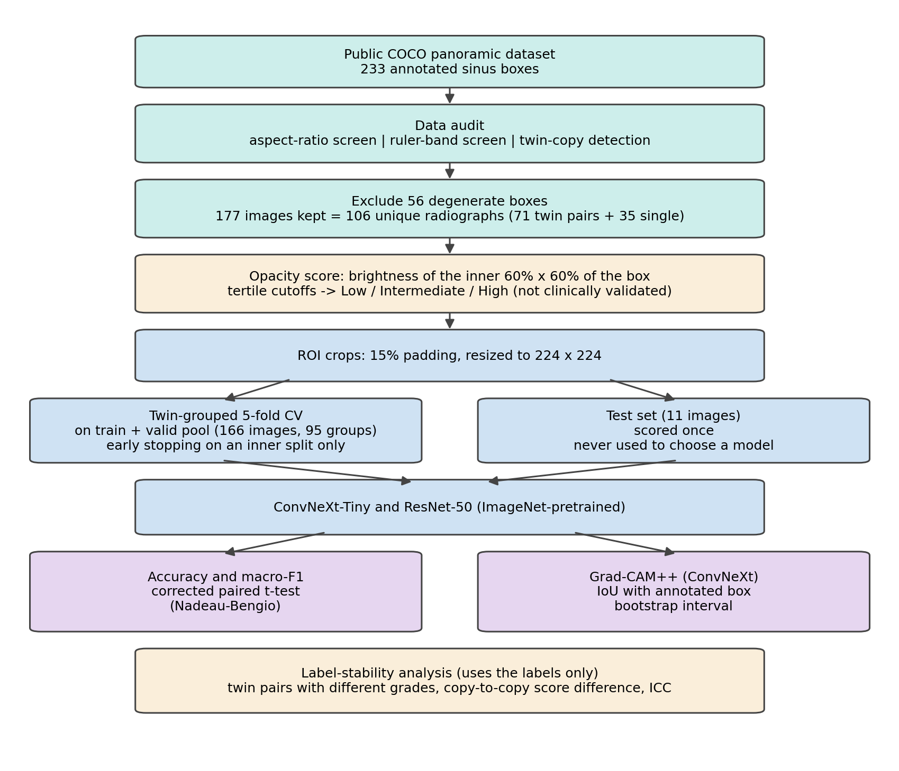

# Sinus opacity grading on panoramic radiographs

ROI-based deep learning for **maxillary sinus opacity grading** on panoramic dental
radiographs, with a dataset audit, a label-stability analysis and a Grad-CAM++ overlap
evaluation. This repository accompanies a manuscript in preparation.

> **Status and honest scope.** The three classes (Low / Intermediate / High opacity) are
> **tertiles of an automated brightness score**. No expert graded the images, the grades are
> **not clinically validated**, and they proved **unstable** between near-identical copies of
> the same radiograph. Nothing here supports a diagnostic claim. The SAD ODE and Markov
> parts are a mathematical illustration only (see the paper's Appendix A).

## Main findings

- **Data audit.** 233 sinus boxes in the public dataset: 56 (24.0%) degenerate (aspect ratio > 3),
  a ruler/scale-bar band flagged in 105 (45.1%). 177 images kept.
- **Twin copies.** All 142 cleaned training images lie in 71 pairs of near-identical copies, so the
  cleaned data hold **106 unique radiographs** (71 + 24 validation + 11 test). Cross-validation
  therefore keeps each pair in the same fold.
- **Unstable labels.** 28 of 71 twin pairs received different grades (median copy-to-copy score
  difference 10.5, middle grade band 16.0 wide, ICC 0.82).
- **Models.** ConvNeXt-Tiny and ResNet-50 cannot be told apart (corrected paired t = 0.34).
- **Explainability.** Mean Grad-CAM++ IoU with the annotated box is 0.167 (95% bootstrap CI 0.11-0.22,
  n = 11); in several overlays the attention lies outside the sinus.

| | ConvNeXt-Tiny | ResNet-50 |
|---|---|---|
| CV accuracy (5-fold, twin-grouped) | 0.623 ± 0.120 | 0.595 ± 0.149 |
| CV macro-F1 | 0.600 ± 0.149 | 0.584 ± 0.164 |
| Test accuracy (n = 11, 95% Wilson CI) | 0.727 (0.43-0.90) | 0.909 (0.62-0.98) |

Single run, seed 42. With 106 unique radiographs and 11 test images these numbers are indicative only.



## Repository layout

```
config.py          paths and settings (set the dataset location here or via an environment variable)
src/               pipeline scripts, numbered in running order (see below)
docs/figures/      figures of the paper that contain no dataset images
results/           put small result CSVs here if you want to publish them
```

## Setup

1. **Get the data.** Download the COCO-format export of the public
   [Dental Disease Panoramic Detection Dataset](https://www.kaggle.com/datasets/lokisilvres/dental-disease-panoramic-detection-dataset)
   from Kaggle. The dataset is **not** redistributed here; check its page for the terms of use.
2. **Point the code at it.** Set the folder that contains `annotations/`, `train/`, `valid/` and `test/`:
   ```powershell
   $env:SINUS_DATASET_ROOT = "D:\data\COCO"      # Windows PowerShell
   ```
   ```bash
   export SINUS_DATASET_ROOT=/data/COCO          # Linux / macOS
   ```
   (or edit `DATASET_ROOT` in `config.py`).
3. **Install.**
   ```bash
   python -m venv .venv
   # activate it, then:
   pip install -r requirements.txt
   ```
   Developed with PyTorch 2.11 (CUDA 12.8) on Windows with an NVIDIA RTX 5050 laptop GPU. A GPU is
   recommended for training.

## Running the pipeline

Run from the repository root, in this order:

| # | Command | What it does | Main output (in `outputs/`) |
|---|---|---|---|
| 1 | `python src/01_verify_dataset.py` | Check classes and sinus counts | console |
| 2 | `python src/08_check_bbox_quality.py` | Audit: aspect ratio and ruler-band screens | `labels/bbox_quality_report.csv` |
| 3 | `python src/02b_auto_severity_scoring.py` | Brightness score and tertile grades (skips degenerate boxes) | `labels/sinus_severity_labels.csv` |
| 4 | `python src/03_roi_extraction.py` | Crop and resize the sinus ROIs | `rois/`, `labels/roi_crop_metadata.csv` |
| 5 | `python src/11_check_twins.py` | Verify the twin-pair structure of the training split | console |
| 6 | `python src/04b_train_convnext_kfold.py` | ConvNeXt-Tiny: twin-grouped 5-fold CV, final model, test | `labels/kfold_results.csv`, `labels/cnn_predictions.csv`, `models/` |
| 7 | `python src/04c_train_resnet50_baseline.py` | ResNet-50 with identical folds and protocol | `labels/resnet50_kfold_results.csv`, `labels/resnet50_test_predictions.csv` |
| 8 | `python src/09_significance_test.py` | Paired t-test with the Nadeau-Bengio correction | console |
| 9 | `python src/05_gradcam.py` | Grad-CAM++ overlays and IoU with the annotated box | `labels/gradcam_iou_scores.csv`, `figures/` |
| 10 | `python src/12_check_label_stability.py` | Twin-pair label stability (flips, copy difference, ICC) | console |
| 11 | `python src/06_ode_fitting.py` | Appendix: SAD ODE fit and bootstrap | `labels/sad_ode_results.csv` |
| 12 | `python src/07_trajectory_fusion.py` | Descriptive opacity index and trajectory-matching diagnostic | `labels/trajectory_fusion_results.csv` |
| 13 | `python src/10_embedded_markov_matrix.py` | Appendix: discrete-time matrix from the fitted ODE | `labels/embedded_markov_matrix.csv` |
| 14 | `python src/14_make_paper_figures.py` | Rebuild the data figures from the CSVs and check the numbers | `paper_figures/` |

Optional: `00_preview_crops.py` and `07_check_ruler_artifact.py` (contact sheets for visual
inspection), `02_grading_tool.py` (manual grading window), and `02c`, `02d`, `13` (export and
analysis for an expert-validation study, which the paper does not include).

## Notes

- **Twin pairs are specific to this dataset export.** In the training split, copies of one radiograph
  have consecutive image ids (odd id, next even id). `group_id()` in `04b`/`04c` relies on this. If you
  use other data, run `11_check_twins.py` first and adapt `group_id()`.
- **Model selection never touches scored data.** Early stopping uses an inner split of the training part;
  the scored CV fold and the test set are not used to choose an epoch.
- **Why NumPy metrics?** On the development machine a Windows Application Control policy blocked compiled
  SciPy and scikit-learn modules, so metrics, fold construction, rank correlation and the paired tests are
  implemented in NumPy (`src/simple_metrics.py`). Only `06_ode_fitting.py` needs SciPy.
- **File names.** `sinus_severity_labels.csv` and some script messages still say "severity". The paper calls
  these grades "opacity grades"; they are the same thing.
- **Reproducibility.** All seeds are 42 and cuDNN is set to deterministic mode, which reduces but may not remove
  run-to-run variation on GPU. Expect small differences if you rerun.

## Limitations

No expert-graded labels; grades are relative brightness ranks and unstable between copies; 106 unique
radiographs and an 11-image test set (very wide intervals, low power); no patient identifiers, so patient-level
leakage cannot be excluded; one public dataset and no external validation; no brightness-only baseline and no
chance baseline for IoU; the ruler band remains in 71 of the 177 crops; the opacity index is in-sample.

## Citation

The manuscript is not published yet. we will add it here once it get published.
## License

Code: MIT (see `LICENSE`; replace the copyright holder first). The dataset has its own license and is not
included.
